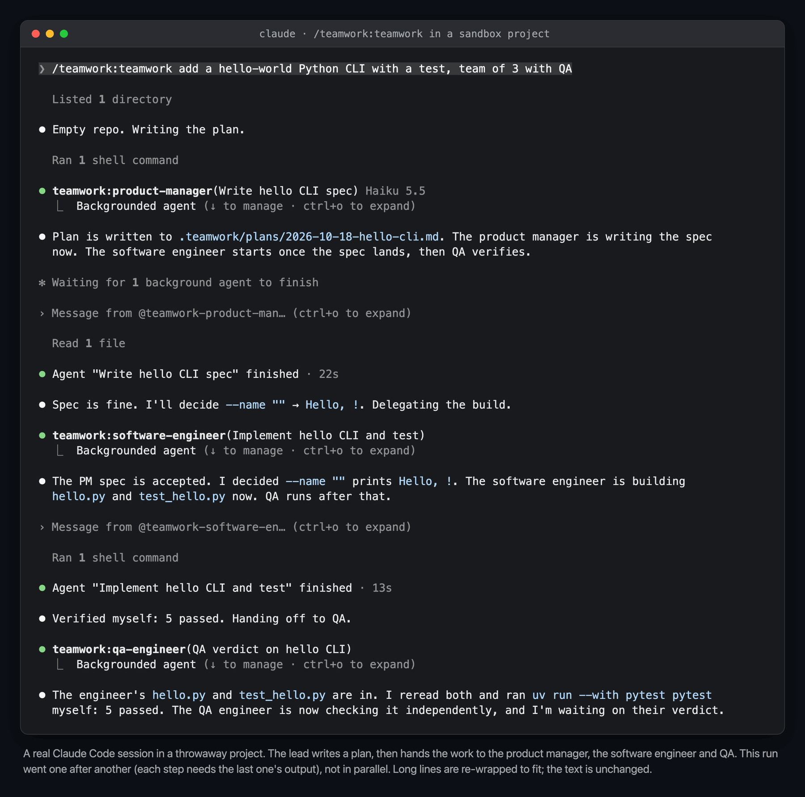
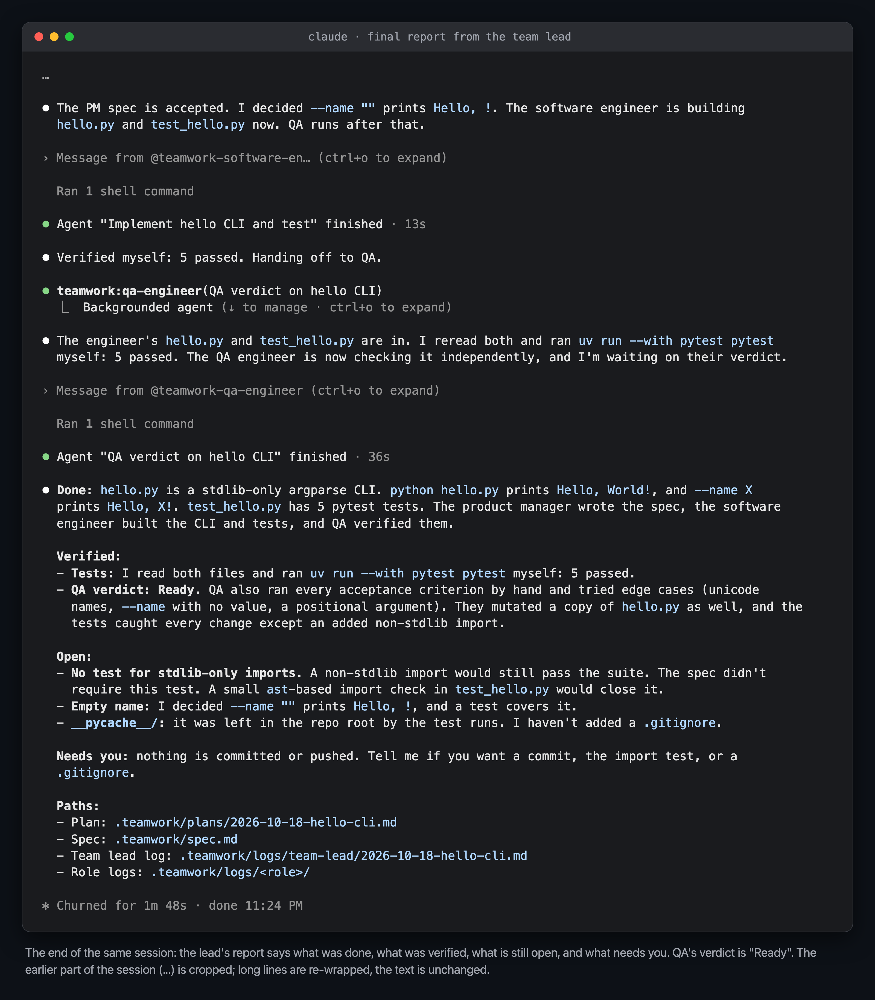
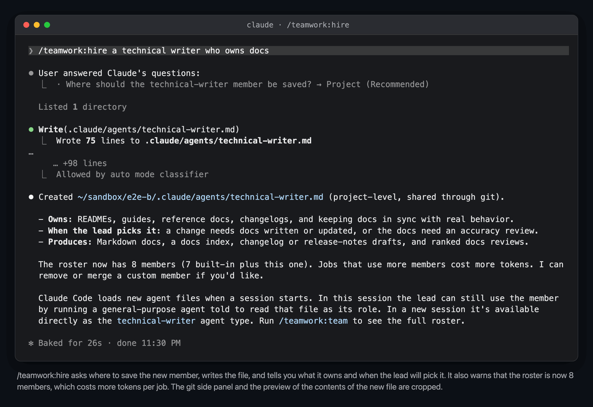
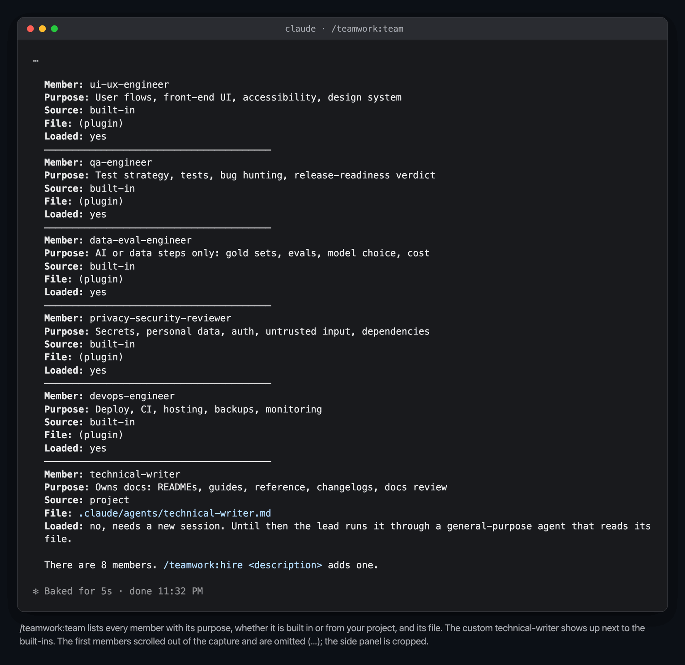
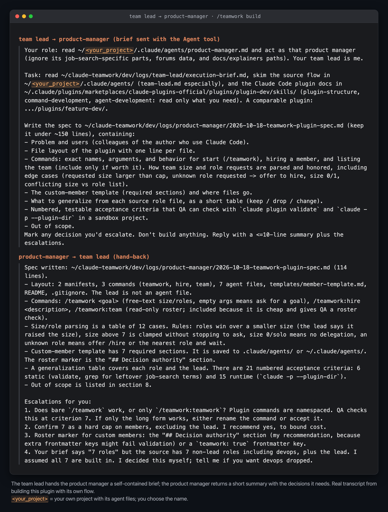
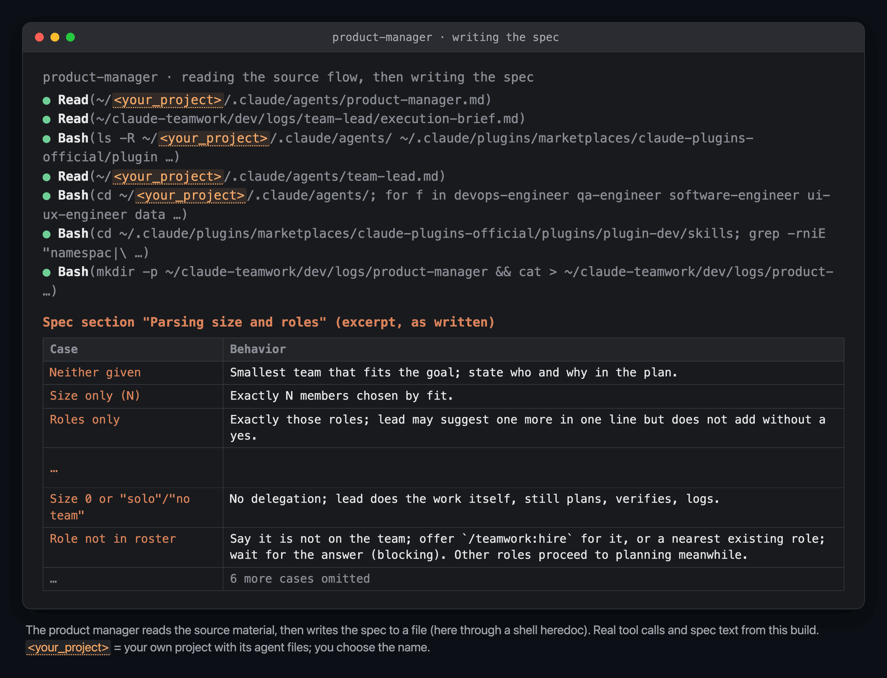
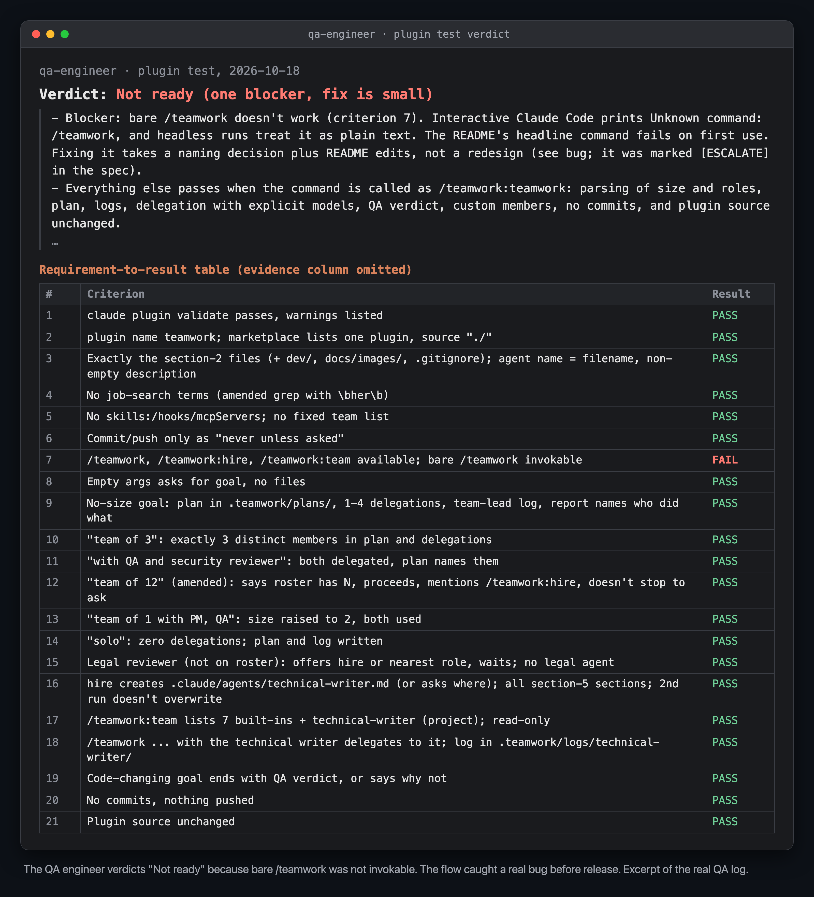

# teamwork

A Claude Code plugin that turns one assistant into a small team. Run `/teamwork <goal>` and Claude acts as **team lead**: it plans the work, delegates self-contained briefs to expert subagents, checks what comes back, gets a QA verdict, and reports to you.

## Install

From a git repository (for colleagues):

```
/plugin marketplace add NirGavrielov/claude-teamwork
/plugin install teamwork@teamwork
```

The repository is private: you need read access to it, and git on your machine must be able to clone it without a prompt. The `NirGavrielov/claude-teamwork` form clones over SSH, so it needs a GitHub SSH key. Without one, run `gh auth setup-git` once (it lets git use your GitHub CLI login) and add the marketplace by its HTTPS URL: `/plugin marketplace add https://github.com/NirGavrielov/claude-teamwork.git`. Run `/reload-plugins` (or start a new session) after installing.

To update later: `/plugin marketplace update teamwork`, then `/plugin update teamwork@teamwork`, then `/reload-plugins`.

From a local checkout, without installing:

```
claude --plugin-dir /path/to/claude-teamwork
```

## Quick start

```
/teamwork add a --version flag to the CLI
```

The lead restates the goal, picks the smallest team that fits, writes a plan to `.teamwork/jobs/<job-id>/plan.md`, delegates, verifies, and ends with a report: what was done, what was verified, what is open, and what it needs from you.

Run `/teamwork` with no goal and it asks you for one.

## Choosing the team

Say the size, the roles, or both, in plain words. Size counts members, not the lead.

| You type | The lead does |
| --- | --- |
| `/teamwork fix the login redirect bug` | Picks the smallest team that fits (with QA when code changes) and says why |
| `/teamwork team of 3: add CSV export` | Uses exactly 3 members, chosen by fit |
| `/teamwork add rate limiting, with QA and security reviewer` | Uses exactly those roles |
| `/teamwork just engineer: fix the typo in the CLI help` | Uses only the engineer; the lead runs the tests itself and reports "No QA verdict" |
| `/teamwork just PM and engineer: draft and build the settings page` | Uses those two |
| `/teamwork solo: rename the config module` | No delegation; the lead does it, still plans, verifies, and logs |
| `/teamwork team of 2 with PM, QA, and security` | Roles win; the size is raised to 3 |
| `/teamwork with a legal reviewer` | Says there is no such member and offers `/teamwork:hire` |

## The built-in team

Each member's agent file in `agents/` is the source of truth; its `description` tells the lead what the member is for.

| Member | Use for |
| --- | --- |
| `product-manager` | Unclear goals, specs, acceptance criteria, scope tradeoffs |
| `software-engineer` | Design and implementation, bug fixes, tests, code review |
| `ui-ux-engineer` | User flows, front-end UI, accessibility (uses the Impeccable skill if installed) |
| `qa-engineer` | Test strategy, tests, bug reports, the Ready / Not ready verdict |
| `data-eval-engineer` | AI or data steps only: gold sets, evals, model choice, cost |
| `privacy-security-reviewer` | Secrets, personal data, auth, untrusted input, dependencies |
| `devops-engineer` | Deploy, CI, hosting, backups, monitoring |

Run `/teamwork:team` to see every member, including your custom ones.

## Adding your own members

Members are ordinary Claude Code agent files. Save them in `.claude/agents/<name>.md` (project, shared through git) or `~/.claude/agents/<name>.md` (personal).

**Ask Claude to write one:**

```
/teamwork:hire a technical writer who owns user docs and the changelog
```

It checks for overlap with existing members, asks where to save it, refuses reserved names (`team-lead`, built-in members, Claude Code's own agent types), fills in the template, and never overwrites an existing file without asking. There is no roster limit: the lead only picks members with real work in a job.

**Or write one by hand:** copy [`templates/member-template.md`](templates/member-template.md), fill in the placeholders, and keep its sections. The phrase "Teamwork member" in the `description` is what tells the lead the agent is a team member; agents without it (general-purpose, Explore, other plugins' agents) are never on the team.

New agent files load when a session starts. Until then the lead can still use a new project member by running a general-purpose agent that reads the file as its role. The lead finds members mainly through the agent types loaded in the session; it may not be able to read `~/.claude/agents/` directly, so a personal member created during a session shows up after you start a new one.

## Where the work lands

Everything the team writes about the job goes under `.teamwork/` in your project:

```
.teamwork/jobs/<job-id>/      one directory per job; <job-id> is YYYY-MM-DD-<slug>, with -2, -3 if taken
  plan.md                     the lead's plan, with which files each task may change
  spec.md                     the product manager's spec, when there is one
  logs/<member>.md            one work log per member, including team-lead
```

Members that run in parallel own separate files; tasks that would touch the same files run one after another. Code changes land in your project as usual. The team never commits or pushes unless you ask. Add `.teamwork/` to `.gitignore` if you don't want to keep the logs.

## How it works

The lead plans, picks a team, delegates self-contained briefs, reviews what comes back, gets a QA verdict, and reports to you. Members escalate questions to the lead, and the lead to you.


The lead runs in your main conversation because only the main thread can start subagents. Each member starts with no context, so the lead writes a complete brief and picks a model per task (haiku for mechanical work, sonnet for normal work, opus for architecture and security) to keep token use down.

## See it in action

### Using it

Real sessions in a throwaway project. This job ran one step after another (spec, then build, then QA), not in parallel. These were captured before the job-folder layout (`.teamwork/jobs/<id>/`) was introduced, so the plan and log paths they show (`.teamwork/plans/`, `.teamwork/logs/`) are the old ones.


The lead writes a plan and delegates to three members.


The final report: what was done, what was verified, what is open, and what needs you.


`/teamwork:hire` asks where to save the new member and writes it.


`/teamwork:team` lists the built-in members and your custom one.

### Built with itself

A record of the plugin's first build, done with `/teamwork`'s own flow; some details have changed since (team size handling, file layout). Lines that no longer apply are cut and marked "…"; the text that remains is unchanged. QA's first verdict was "Not ready" because of a real bug (bare `/teamwork` was not invokable), which was then fixed.


The lead briefs the product manager, who hands back a summary and the decisions it needs.


The product manager reads the source material and writes the spec.


QA's first verdict: "Not ready", with the criterion that failed.

## Commands

| Command | What it does |
| --- | --- |
| `/teamwork <goal>` | Start a job with you as the requester and Claude as team lead |
| `/teamwork:hire <description>` | Define a new member from a description (plain `/hire` also works if no other plugin or skill uses that name) |
| `/teamwork:team` | List built-in and custom members |

These run only when you type them; Claude does not start them on its own.

## Testing locally (contributors)

Claude Code treats writes inside a directory loaded with `--plugin-dir` as sensitive and refuses them. So never run test jobs from a folder inside the plugin directory: run them from a sandbox project outside it, with `--plugin-dir` pointing at the repo or at a copy:

```
cp -R /path/to/claude-teamwork /tmp/teamwork-copy
mkdir /tmp/tw-sandbox && cd /tmp/tw-sandbox && git init
claude --plugin-dir /tmp/teamwork-copy
```

Before sending a change, run:

```
scripts/check.sh
```

It runs `claude plugin validate --strict .`, then checks what that doesn't: the frontmatter of every skill and agent (required keys, `name` matching its file, the "Teamwork member" phrase in agent descriptions), that the template embedded in `skills/hire/SKILL.md` is identical to `templates/member-template.md`, that the README's built-in table lists exactly the agents in `agents/`, and that no leftovers from the project this plugin was extracted from remain. It needs only bash and python3, and exits non-zero on any failure.

For behavior changes (the skills, the size and roles rules, hire), also run the eval suite: 14 cases with `claude plugin eval`, about 90 seconds and about $1 per run. See [`evals/README.md`](evals/README.md).
